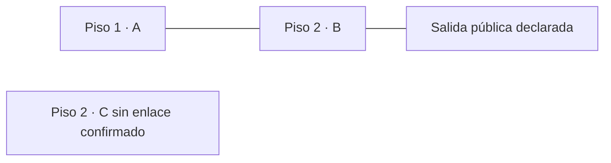

# Fase 3D — Conectividad preventiva

Se verificaron proyección punto–segmento, distancia al perímetro, clasificación geométrica de conectores y alcanzabilidad BFS. El análisis opera sobre declaraciones del croquis y no certifica evacuación, operatividad ni seguridad ITSE. Se conserva el aviso legal y la distinción entre conexión confirmada, sugerida, flotante e indeterminada.

## Defectos de topología

| ID | Defecto | Corrección y evidencia |
| --- | --- | --- |
| D-3D-09 | Códigos iguales en pisos distintos sobrescribían nodos y producían conteos/alcanzabilidad incorrectos | Identidad interna piso+código, sin prohibir esa geometría válida; GRAFO-3D-01, ROJO 03 |
| D-3D-10 | Conexión vertical podía confirmarse sin llegada y no se representaba una ruta válida entre pisos; SQL perdía referencias a niveles posteriores | Declaración explícita de llegada, validación contra el nivel destino, persistencia en dos pasos y arista entre nodos de pisos distintos; GRAFO-3D-02/03, ROJO 03/06 |

La primera corrección de integridad (04) dejó 20 aprobadas/1 fallida: la conexión vertical revelaba divergencia porque su FK a un nivel aún no creado quedaba null. Se corrigió el orden de persistencia; 05 aprobó los 21 casos originales. No era un fixture incorrecto ni se relajó la auditoría para aceptar esa divergencia.

Solo conexiones confirmadas entran en el grafo. Una escalera sin ambiente de llegada queda indeterminada; un destino no identificado no se adivina. Una declaración vertical cuyo punto no coincide con el perímetro de llegada no se considera confirmada. No se infiere conectividad por cercanía únicamente ni por una sugerencia IA.

## BFS y representación

La búsqueda parte de todas las salidas públicas confirmadas, recorre adyacencias bidireccionales y marca cada nodo una sola vez. Se sustituyó array_shift por un índice de cola creciente: conserva FIFO y evita desplazar todo el array en cada extracción. La visita es O(V+E); la clasificación geométrica previa y la comprobación de polígonos tienen costes adicionales, no se presentan como un motor global O(V+E).

Esquema ilustrativo de alcanzabilidad; no plano técnico. El código se conserva como etiqueta pública y el resumen por ambiente incluye numero_piso. Las listas planas de códigos pueden contener etiquetas repetidas entre pisos; usar piso+código para identificar un ambiente. No se cambió el tipo de respuesta API ni se rediseñó el editor.

## Matriz de casos

| Caso | Resultado verificado |
| --- | --- |
| GRAFO-3D-01 | Dos ambientes con el mismo código en pisos distintos se cuentan por separado; solo el piso con salida declarada queda alcanzado |
| GRAFO-3D-02 | Escalera con piso destino pero sin ambiente de llegada no confirma conexión |
| GRAFO-3D-03, tres datasets | Rutas verticales explícitas hacia piso 2, planta 0 y sótano -1 alcanzan la salida; FK de destino persistida correctamente |
| GRAFO-3D-04, dos datasets | Cadenas indirectas de 3 y 100 ambientes alcanzan salida, sin duplicar nodos |
| GRAFO-3D-05, dos datasets | Componentes separados: una salida alcanza solo su componente; varias salidas pueden cubrirlos todos |
| GRAFO-3D-06, dos datasets | Ciclo de cuatro ambientes termina con/sin salida y da la alcanzabilidad esperada |
| GRAFO-3D-07 | Conectores duplicados no duplican ambientes alcanzados; el contador de conectores conserva las tres declaraciones recibidas |
| AnalisisEspacialPreventivoTest existente | Conector flotante, origen/destino inexistente, proximidad sin declaración suficiente, ambiente aislado y exclusión de elementos ilustrativos |
| SugerenciasEspacialesMultimodalTest existente | Sugerencia no se inserta automáticamente, confirmación/rechazo, evidencia alterada, idempotencia y drift |

No se deduplican silenciosamente conectores del snapshot ni se convierten sugerencias en mediciones. Las referencias verticales se evalúan en el nivel de destino declarado y las relaciones SQL se reconstruyen con identidad de piso, evitando que un código homónimo permita validar una FK equivocada (PLAN-3D-13).

## Resultados, interpretación y límites

La selección 15 contiene 190 pruebas aprobadas/440 aserciones entre geometría, espacio, autorización y aislamiento. La regresión completa final contiene 703 aprobadas/4524 aserciones. No sumar selecciones como casos únicos. Evidencias de ejecución/JUnit en evidencias-fase3d/.

El caso de 100 ambientes es una prueba funcional de carga sintética, no un benchmark de producción ni evidencia de capacidad ilimitada. No se ejecutaron concurrencia real, simulación física de evacuación, inspección de anchuras reglamentarias, métricas oficiales de recorridos ni análisis de humo. La tolerancia 0.20 m se preserva como contrato técnico existente y no se declara normativa. Los resultados no sustituyen verificación humana ni una evaluación oficial.
