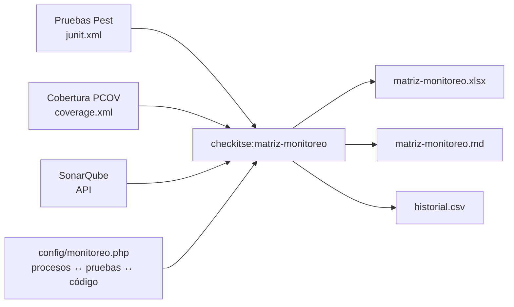

# Matriz de doble entrada para el control y monitoreo

## Qué es

Una tabla que se lee en dos sentidos:

- **Filas:** los 13 procesos del mapa de macroprocesos (E1–E2, M1–M6, S1–S5; ver [docs/informe/README.md](../informe/README.md)).
- **Columnas:** los indicadores con que se controla cada proceso.
- **Cada celda:** el valor de ese indicador para ese proceso.

Así se ve de un vistazo qué parte del sistema está bien y cuál necesita atención.

## Indicadores (columnas)

| Indicador | Qué mide | De dónde sale |
| --- | --- | --- |
| Pruebas / Aprobadas / Fallidas / % Éxito | Si el proceso funciona como se espera | Reporte JUnit de Pest (`junit.xml`) |
| Cobertura % | Qué parte de su código está ejercitada por pruebas | Reporte Clover (`coverage.xml`) |
| Bugs / Vulnerabilidades / Code smells | Defectos, riesgos de seguridad y mantenibilidad | API de SonarQube |
| Estado (semáforo) | Resumen del proceso | Regla automática (abajo) |
| Responsable | Quién responde por el proceso | `config/monitoreo.php` |

## Regla del semáforo

| Estado | Condición |
| --- | --- |
| 🟢 Verde | Todas sus pruebas pasan, la cobertura es ≥ 80 % y no hay bugs ni vulnerabilidades abiertos |
| 🟡 Amarillo | Las pruebas pasan, pero la cobertura está bajo 80 % o falta ejecutar una prueba declarada |
| 🔴 Rojo | Alguna prueba falla, el proceso no tiene pruebas o hay bugs/vulnerabilidades abiertos |

El 80 % coincide con el Quality Gate de SonarQube y se cambia en `config/monitoreo.php`.

## Por qué es automática

Nadie llena la matriz a mano. Cada proceso declara en `backend/config/monitoreo.php` qué archivos de prueba lo respaldan y qué código lo implementa. A partir de eso, el comando cruza los reportes y calcula todo:



Se actualiza de dos formas:

1. **Local, con un comando:**
   ```powershell
   .\scripts\monitoreo.ps1                  # pruebas + cobertura + matriz
   .\scripts\monitoreo.ps1 -Token TU_TOKEN  # además, suma los datos de SonarQube
   ```
2. **En GitHub, en cada `push`:** el flujo `.github/workflows/tests.yml` ejecuta las pruebas, genera la matriz, la muestra en el resumen de la ejecución (pestaña *Actions*) y la deja descargable como `matriz-monitoreo`.

## Archivos que genera (en esta carpeta)

| Archivo | Contenido |
| --- | --- |
| `matriz-monitoreo.xlsx` | Excel con 3 hojas: **Matriz** (semáforo por color), **Resumen** (por nivel y global) e **Historial** |
| `matriz-monitoreo.md` | La misma matriz, legible en GitHub |
| `historial.csv` | Una fila por proceso en cada ejecución: muestra la evolución en el tiempo |

## Cómo se agrega un proceso o una prueba

Edita `backend/config/monitoreo.php`: agrega el archivo de prueba al proceso que respalda. Si una prueba no pertenece a ningún proceso, la matriz la lista como **"sin proceso asignado"**, para que nada quede fuera del control.

## Código

| Archivo | Responsabilidad |
| --- | --- |
| `backend/app/Services/Monitoreo/MatrizMonitoreoService.php` | Lee los reportes, cruza procesos con indicadores y aplica el semáforo |
| `backend/app/Services/Monitoreo/ExportadorMatriz.php` | Genera el Excel (sin librerías externas), el Markdown y el historial |
| `backend/app/Console/Commands/GenerarMatrizMonitoreo.php` | Comando `php artisan checkitse:matriz-monitoreo` |
| `backend/tests/Feature/MatrizMonitoreoTest.php` | Pruebas de la propia matriz |
| `scripts/monitoreo.ps1` | Ejecuta todo con un solo comando |
