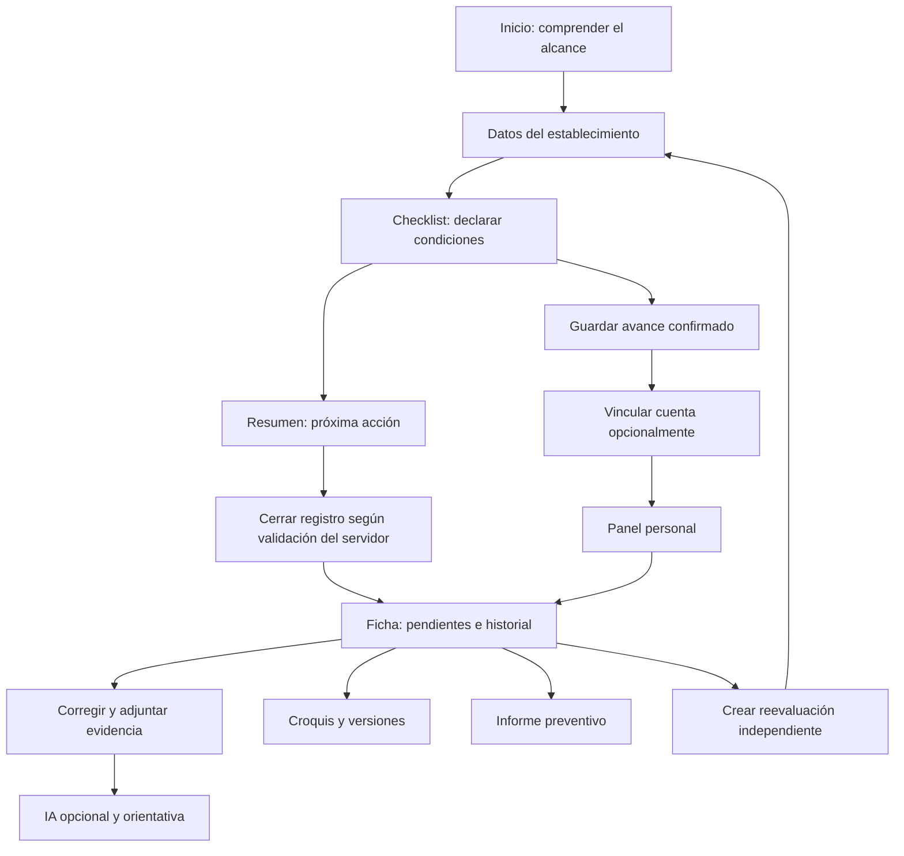

# Rediseño funcional propuesto

Todo lo siguiente es especificación pendiente, no interfaz implementada. Mantener URLs, nombres de rutas, props y payloads actuales. Las etiquetas visibles pueden simplificarse; los valores normativos, autorización, reglas de cierre y hashes no cambian. Estimaciones de complejidad son relativas; el esfuerzo orientativo figura en 05.

## Arquitectura de navegación



Mapa conceptual; no propone crear estos nodos como nuevas rutas. El resumen puede consultarse en las condiciones actuales de la aplicación; el cierre requiere las precondiciones reales del servidor. Nunca forzar respuestas para avanzar ni reabrir un registro cerrado. La navegación de invitado conserva cookie/sesión autorizada: un enlace o UUID no habilita acceso desde otro equipo.

Navegación global propuesta: «Inicio», «Mis revisiones» para autenticados, «Ayuda técnica» para directorio y «Mi cuenta»; acción «Revisar mi local». Dentro del expediente: «Qué atender», «Evidencias», «Croquis», «Historial» e «Informe», sin abrir una barra distinta por sección. Mantener enlaces públicos y cierre de sesión. Detalles normativos e integridad son enlaces contextuales, no pasos obligatorios nuevos.

## 1. Inicio

- Problema actual: Home mezcla valor, estimación local, métricas no medidas, ejemplo de consola y extensa normativa; múltiples nombres para iniciar.
- Objetivo: saber qué ofrece y comenzar sin confundirlo con un trámite oficial.
- Esencial: «Identifica qué revisar en tu local», explicación preventiva de una frase, CTA «Revisar mi local» y opción de retomar con cuenta.
- Secundario: cómo funciona en tres pasos, ejemplo claramente ficticio, alcance/limitaciones y normativa bajo expansión. Quitar «Tiempo promedio: 3 min» hasta medirlo; no prometer evitar sanciones.
- Componentes: hero sobrio, una CTA principal, tres pasos, FAQ con accordion y avisos breves; aprovechar Navbar/Footer existentes.
- Navegación: CTA a autoevaluacion.nueva; registro/login secundarios y directorio contextual.
- Accesibilidad: H1 único, enlace de salto existente, contraste medido y CTA legible en móvil; ninguna información solo en una ilustración.
- Aceptación: AC-01/02/03; el visitante explica el carácter no oficial y comienza sin cuenta.
- Complejidad: baja-media. Riesgo: cambiar promesas comerciales o reglas del estimador local. Simplificar presentación, no retocar umbrales sin validación técnica.

## 2. Registro e inicio de sesión

- Problema: identidad visual distinta y conversión que puede interrumpir la tarea; no eliminar los buenos errores/autocomplete existentes.
- Objetivo: acceder o conservar trabajo y volver al contexto correcto.
- Esencial: correo/contraseña para login; datos obligatorios reales y confirmación en registro; teléfono sigue opcional.
- Secundario: beneficios de cuenta y advertencia de uso; no solicitar datos comerciales adicionales.
- Componentes: AuthLayout coherente, Field, botón loading, retorno explícito. No prometer recuperación de contraseña si no existe endpoint.
- Navegación: login/register actuales; ModalGuardarProgreso conserva vinculación autorizada y retorno. Sin reintentar una operación ya confirmada al cerrar modal.
- Accesibilidad: label, autocomplete, errores enlazados y foco al resumen/primer error; icono mostrar contraseña con nombre y estado.
- Aceptación: AC-04/05 y contratos de autenticación; cuenta errónea no vincula expedientes ajenos.
- Complejidad: media. Riesgo: romper sesión, CSRF, throttle o invitado. No guardar tokens/credenciales en localStorage ni enlaces públicos.

## 3. Panel ciudadano

- Problema: KPIs, porcentajes, semáforos, sellos y múltiples acciones tienen peso parecido; «local» puede equivaler en realidad a una autoevaluación.
- Objetivo: retomar el proceso correcto y elegir una próxima acción.
- Esencial: nombre declarado, fecha, estado del proceso y acción «Continuar»/«Ver pendientes»; búsqueda solo sobre datos ya recibidos.
- Secundario: resumen agregado e integridad técnica; no presentar registros/reevaluaciones como número real de sedes sin entidad/agrupación validada.
- Componentes: RecordCard, filtros accesibles, lista vacía y ficha de proceso; KPIs acompañados de definición y denominador.
- Navegación: dashboard, mis-autoevaluaciones y expediente existentes. No sumar «aprobados» como certificaciones.
- Accesibilidad: tarjetas con título y un enlace principal, listas semánticas y estado textual; no meter botones anidados en un enlace.
- Aceptación: AC-06/07; conjunto recibido y permisos no cambian; borrador y cerrado se distinguen sin color.
- Complejidad: media. Riesgo: contar reevaluaciones dos veces o introducir una agrupación inexistente. Primero aclarar la unidad del registro.

## 4. Registro de establecimiento

- Problema: Nueva reúne identificación, magnitudes, características, preclasificación y ayuda técnica en un formulario.
- Objetivo: aportar la información que conoce sin inventar valores.
- Esencial: nombre/actividad requeridos; restantes campos según contrato actual, unidades visibles y condición de opcionalidad.
- Secundario: referencias legales y estimación, mostrando que no es clasificación oficial.
- Componentes: tres grupos «Tu local», «Características», «Revisar datos»; TriStateQuestion para características, Field con unidad y ayuda simple.
- Navegación: grupos cliente dentro de Nueva; un POST al completar, mismas claves y ruta. Antes del POST no existe guardado remoto; decir «Aún no has guardado estos datos» si se intenta salir.
- Accesibilidad: controles nativos, leyendas de grupo, errores de servidor y locales asociados, foco útil al cambiar de grupo.
- Aceptación: AC-08/09; volver entre grupos conserva memoria de la sesión de pantalla, false y null permanecen distintos, 422 no borra datos.
- Complejidad: media-alta. Riesgo: transformar null, alterar validación o prometer borrador persistido. No implementar autosave sin contrato de persistencia.

## 5. Autoevaluación paso a paso

- Problema: indicadores hablan de «Calcular riesgo», «Simulacro» y «Veredicto», mezclando el proceso con un resultado oficial.
- Objetivo: entender dónde está y qué sigue.
- Esencial: «Datos → Condiciones → Resumen», paso actual y si los cambios están confirmados por el servidor.
- Secundario: ayudas, ámbito temporal y relación con reevaluación anterior.
- Componentes: ProgressStepper compartido, título y resumen de guardado; no crear otra página o formulario duplicado.
- Navegación: Nueva → Checklist → Resumen con rutas existentes; guardar avance continúa siendo una operación explícita compatible.
- Accesibilidad: aria-current para paso actual, nombre del paso, encabezado enfocado tras navegación y scroll que respete movimiento reducido.
- Aceptación: AC-10/11; progreso = respuestas/condiciones del flujo, nunca porcentaje de seguridad; cerrar no se activa saltando validaciones.
- Complejidad: media. Riesgo: un wizard visual puede ocultar datos obligatorios o confundir avanzar con cerrar; validar estados del backend.

## 6. Checklist normativo

- Problema: preguntas, categorías, códigos, material pedagógico y avisos compiten en cada tarjeta; hay valores visuales no unificados.
- Objetivo: responder con criterio y localizar lo pendiente.
- Esencial: pregunta ciudadana, tres respuestas declarables, nota opcional, estado de guardado y avance real.
- Secundario: norma/código, foto de ejemplo con descripción, explicación y recursos educativos. NO_APLICA se consulta como decisión del sistema, nunca como botón editable.
- Componentes: CriterionCard, radio-group/fieldset, filtros «Por responder/Respondidas», SaveStatus y barra de acciones única.
- Navegación: categorías o lista con apertura progresiva; permitir revisar lo respondido; «Guardar avance» y «Continuar al resumen» conservan precondiciones actuales.
- Accesibilidad: seleccionar con teclado, área táctil completa, feedback anunciado sin mover foco en cada guardado; barra no oculta la última pregunta.
- Aceptación: AC-12/13/14; criterios suspendidos excluidos, categorías/contadores iguales al backend, error conserva edición y no muestra guardado falso.
- Complejidad: alta. Riesgo: recalcular aplicabilidad en cliente, borrar respuestas al filtrar o convertir silencio en cumplimiento. No tocar motor ni catálogo.

## 7. Resultados preventivos

- Problema: Resumen muy extenso y expresiones de salud/veredicto/pronóstico pueden imponerse al aviso de autodeclaración; Resultado legado es otro contrato.
- Objetivo: saber qué atender primero y qué puede hacer ahora.
- Esencial: «Según lo que declaraste», cantidades por estado, próxima acción y cierre/continuación según estado real.
- Secundario: detalle por criterio, características declaradas, recursos, normas y verificación de integridad.
- Componentes: resumen de estados, lista priorizada con motivo visible, aviso no oficial junto al resultado y confirmación de cierre explícita. No inventar prioridad legal/técnica si el backend no la entrega: usar pendiente/revisión y orden actual.
- Navegación: corregir, añadir evidencia cuando corresponda, croquis/informe secundarios; tras cerrar, nueva reevaluación en vez de editar original.
- Accesibilidad: contadores con texto, gráfico redundante opcional y orden de lectura consistente; no una gran insignia verde que contradiga el aviso.
- Aceptación: AC-15/16; sin «aprobado»/garantías, no cambia el snapshot al desplegar secciones; cerrado no editable.
- Complejidad: alta. Riesgo: homogeneizar V1/V2 falsamente o recalcular indicadores. Mantener adaptadores/vistas compatibles.

## 8. Gestión de subsanaciones

- Problema: dos flujos (directo/legado), varias ayudas y alert del navegador; los estados no son los del checklist.
- Objetivo: registrar una mejora, conservar prueba y saber qué sigue pendiente.
- Esencial: condición observada, acción declarada, estado operacional, observación y evidencia vigente.
- Secundario: historial append-only con fecha, notas anteriores, ayudas y proveedores contextuales.
- Componentes: lista de tareas, editor por criterio, error inline, confirmación no oficial y cronología legible.
- Navegación: desde pendientes de la ficha; regresar al mismo criterio tras guardar; evidencia e IA no obligatorias para marcar toda acción.
- Accesibilidad: formulario con nombres, estado anunciado, foco devuelto y botón contextual; ninguna acción solo en hover.
- Aceptación: AC-17/18; guardar idéntico no duplica eventos, nueva evidencia conserva anterior y el sello del diagnóstico no se reescribe.
- Complejidad: media-alta. Riesgo: mezclar SUBSANADO_DECLARADO con aprobación o sobrescribir historia; usar contratos estabilizados en Fase 3C.

## 9. Fotografías y análisis IA

- Problema: discrepancias estáticas de DTO/sondeo, tipos/etiquetas y mensajes; un indicador favorable podría sobreinterpretarse.
- Objetivo: entender qué muestra la foto y qué no puede concluirse.
- Esencial: selección de archivo, formato/tamaño permitido, envío voluntario, estado, calidad/incertidumbre, límites y siguiente acción.
- Secundario: elementos observados, historial de análisis y versión técnica; payload crudo nunca en UI.
- Componentes: EvidenceCard, carga con progreso, IAResult, error con reintento apropiado y ayuda de captura. PDF se almacena como documento pero no ofrece análisis visual.
- Navegación: análisis opcional por evidencia y versión; polling consume JSON raíz actual y se detiene en terminales, al salir o por error/sesión expirada.
- Accesibilidad: modal con foco correcto y feedback anunciado; preview con descripción, alternativa documental y advertencia legible antes de enviar.
- Aceptación: AC-19/20/21; fixtures reales del backend se adaptan a nombres/enums del frontend; incierto = revisión, nunca «cumple»; no recargar automáticamente un análisis cobrable.
- Complejidad: alta. Riesgo: romper contratos, duplicar solicitudes, consumir IA innecesariamente o mostrar elementos no observables como inexistentes. P0 UX-01/02 antes de publicar.

## 10. Editor de croquis 2D

- Problema: lienzo orientado a ratón, herramientas/versiones/formularios/sugerencias compitiendo y etiquetas técnicas pequeñas.
- Objetivo: describir espacios y recorridos sin conocimientos CAD.
- Esencial: planta actual, ambientes, elementos y conexiones declaradas; estado sin guardar y acción de guardar versión.
- Secundario: comparación de versiones, análisis espacial orientativo y procedencia manual/plantilla/IA confirmada.
- Componentes: barra simple «Ambientes/Elementos/Conexiones», inspector contextual y lista equivalente editable. Campos posicion_x/posicion_y y dimensiones mantienen esquema/unidades actuales.
- Navegación: flujo guiado «Define ambiente → Ubica elementos → Revisa conexiones»; versiones consultables sin sobrescribirlas; confirmar/rechazar sugerencia requiere acción explícita.
- Accesibilidad: mover/editar mediante formulario y teclado sin arrastrar, selección nombrada, zoom con controles, táctil verificado y descripción del plano.
- Aceptación: AC-22/23; misma geometría por ratón/lista, límites y conectividad del servidor intactos; origen ilustrativo nunca pasa a dato medido por diseño.
- Complejidad: muy alta. Riesgo: unidades, coordenadas, versiones y acceso; posponer hasta cierre técnico correspondiente, sin comenzar Fase 3D desde este plan.

## 11. Historial

- Problema: MisAutoevaluaciones reusa Dashboard y las revisiones pueden parecer nuevos locales; expediente concentra bastante información.
- Objetivo: localizar qué se declaró y cambió en cada momento.
- Esencial: evaluación original, reevaluaciones relacionadas, fechas y estado; distinguir historia del diagnóstico de historia de evidencias/IA/croquis.
- Secundario: hashes, detalles normativos y exportaciones.
- Componentes: lista/cronología con filtros y etiquetas de origen; ficha de evaluación y comparación solo de campos realmente disponibles.
- Navegación: misma ruta mis-autoevaluaciones y expediente; «Ver original»/«Ver reevaluación» no cambia el propietario ni permite editar registros sellados.
- Accesibilidad: orden cronológico explicable, tablas con encabezados o tarjetas equivalentes, fechas legibles y enlaces con contexto.
- Aceptación: AC-24; ninguna reevaluación cuenta como nueva sede por inferencia; invitado/cuenta ajena no obtiene acceso por enlace.
- Complejidad: media-alta. Riesgo: agrupación errónea y comparación falsa de versiones; respetar relación raíz del backend.

## 12. Informes

- Problema: presentación de expediente, informe y anexos combina jerga, impresión densa y apariencia institucional.
- Objetivo: conservar/compartir información preventiva legible sin presentarla como certificado.
- Esencial: local declarado, fecha, alcance no oficial, resultados y pendientes con su origen.
- Secundario: anexos/referencias, trazabilidad y verificación; textos oficiales conservados íntegros.
- Componentes: lectura responsive, índice de secciones e impresión A4 separada; vista previa y nombres de botones inequívocos.
- Navegación: desde ficha a informe/anexo existentes; impresión/guardar PDF del navegador cuando esté disponible. No afirmar que ya existe un generador de PDF accesible o firmado.
- Accesibilidad: jerarquía de títulos, tablas con encabezados repetidos en impresión, texto real seleccionable y advertencias que no dependan del color.
- Aceptación: AC-25/26; documento no tiene apariencia de aprobación emitida; no se alteran datos/hashes al imprimir, ni desaparece información normativa requerida.
- Complejidad: media-alta. Riesgo: saltos de página, tablas cortadas y cambios jurídicos; diseño no reescribe contenidos normativos oficiales.

## Pantallas complementarias

Directorio: conservar filtros/distrito y libertad de elección; reducir bloque institucional inicial a síntesis ampliable, mostrar claramente qué es información del proveedor y qué no constituye aval. Mejorar contacto y estado vacío sin introducir promoción pagada oculta. Archivos: Directorio/Index, ModalContactoProveedor, ModalAfiliacion y ProveedoresCercanosModal. Complejidad media; AC-27.

Perfil: conservar nombre/correo/teléfono opcional y credenciales actuales; separar edición personal de contraseña, enlazar errores con campos y confirmar éxito. No agregar 2FA, recuperación o roles sin backend. Archivo Perfil/PerfilUsuario; complejidad baja-media; AC-28.

## Esquemas de primera capa

```text
INICIO                       DATOS
Qué puedes revisar           Paso 1 de 3 · Datos
Aviso preventivo breve       Tu local / Características / Revisar
[Revisar mi local]           Campos conocidos + «Aún no lo sé»
Cómo funciona · Ayuda        [Volver] [Continuar]

CHECKLIST                    RESUMEN
Paso 2 · Condiciones         Según tus declaraciones
Respuestas guardadas x/y     Pendientes · Por revisar · Declaradas
Pregunta actual + opciones   Próxima acción concreta
Ayuda ampliable              [Ver qué atender]
[Guardar avance] [Continuar] Cerrar registro · Detalles · Informe
```

Son wireframes textuales de jerarquía, no capturas ni prototipos probados. Los estados vacíos, errores y permisos deben diseñarse con el mismo cuidado que el camino exitoso; los criterios de 06 son la condición para aceptar cada pantalla posteriormente.
